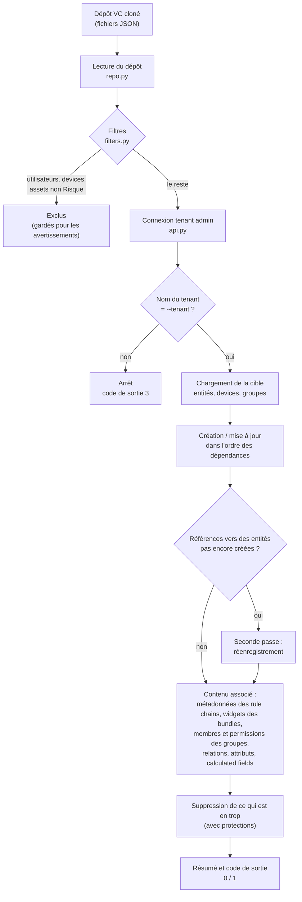
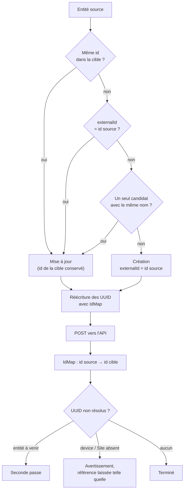
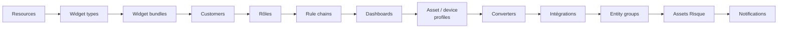

# synctb

Outil en ligne de commande qui synchronise un tenant **ThingsBoard 4.3 PE** enregistré dans
un dépôt de *Version Control* (déjà cloné en local) avec un tenant d'une instance en service.

- Synchronise tout, sauf les utilisateurs et les devices.
- Parmi les assets, seuls ceux de type `Risque` sont synchronisés. Les assets `Site` ne sont jamais touchés.
- Supprime de la cible ce qui n'existe pas dans la source, sauf les assets, les devices et les device profiles.
- La cible peut être le même tenant que la source ou un autre tenant, sur la même instance ou sur une autre.

Les règles détaillées et les décisions de conception sont décrites dans [PLAN.md](PLAN.md).

## Utilisation

```bash
export TB_URL=https://thingsboard.example.com
export TB_USERNAME=tenant.admin@example.com
export TB_PASSWORD=********
export TB_TENANT="Mon Tenant"

synctb ./chemin/du/depot --dry-run   # affiche ce qui serait fait
synctb ./chemin/du/depot             # applique les modifications
```

| Option | Variable d'environnement | Description |
|---|---|---|
| `repo` | — | Chemin du dépôt VC cloné |
| `--url` | `TB_URL` | URL du ThingsBoard cible |
| `--username` | `TB_USERNAME` | Utilisateur **tenant admin** du tenant cible |
| — | `TB_PASSWORD` | Mot de passe (uniquement par variable d'environnement) |
| `--tenant` | `TB_TENANT` | Nom du tenant cible. S'il ne correspond pas à celui de l'utilisateur, l'exécution s'arrête |
| `--dry-run` | — | Ne modifie rien, trace seulement ce qui serait fait |
| `-v` | — | Log au niveau DEBUG |

Les arguments de la ligne de commande ont la priorité sur les variables d'environnement.

### Journalisation et codes de sortie

Le log est écrit uniquement sur la sortie standard. Il se termine par un résumé par type
d'entité : créés, mis à jour, supprimés, conservés et échecs.

| Code | Signification |
|---|---|
| `0` | Synchronisation terminée sans erreur |
| `1` | Synchronisation terminée, mais au moins une entité a échoué |
| `2` | Configuration incomplète ou invalide |
| `3` | Erreur fatale : connexion, mauvais tenant ou dépôt illisible |

Les avertissements ne changent pas le code de sortie. Exemples d'avertissements : une
référence vers un device absent de la cible, ou une suppression refusée par ThingsBoard.

## Fonctionnement

### Vue d'ensemble

`synctb` fait de la cible le reflet de la source, à quelques exceptions près. Les devices,
les assets `Site` et les utilisateurs ne sont jamais copiés, car ils portent des données
propres à chaque instance. Le reste est créé, mis à jour ou supprimé pour correspondre au
dépôt.

Ce qui rend l'outil réutilisable entre tenants, c'est la **table de correspondance des
identifiants** (`IdMap`) :
- **Même tenant.** Les entités gardent leurs identifiants.
- **Autre tenant.** Chaque entité créée reçoit un nouvel identifiant. Toutes les références
  qui pointent vers elle sont alors réécrites : asset vers profile, dashboard vers asset,
  nœud vers rule chain, etc.
- **Exécutions suivantes.** L'identifiant source est enregistré dans le champ `externalId`
  de l'entité créée. Les exécutions suivantes retrouvent ainsi la même entité au lieu de la
  dupliquer : l'outil est **idempotent**.



### Traitement d'une entité

Chaque entité du dépôt passe par les mêmes étapes, dans `syncer.save()` :

1. **Rapprochement.** On cherche l'entité correspondante dans la cible, dans cet ordre :
   - même `id` ;
   - `externalId` égal à l'id source ;
   - même nom, s'il n'y a qu'un seul candidat.

   Le rapprochement par nom permet de réutiliser ce que ThingsBoard crée tout seul : la
   rule chain racine, les profiles par défaut et les groupes d'un nouveau customer.
2. **Préparation du corps.** On retire les champs propres à la source (`id`,
   `createdTime`, `version`). Puis on remplace dans tout le JSON chaque UUID connu par son
   équivalent dans la cible.
3. **Enregistrement.**
   - Entité trouvée : mise à jour en reprenant son `id`. Le contenu de la source l'emporte.
   - Sinon : création, avec `externalId` = id source.
4. **Références non résolues.**
   - Vers une entité qui sera créée plus tard : l'entité est réenregistrée lors de la
     seconde passe.
   - Vers un device ou un asset `Site` absent de la cible : la référence est laissée telle
     quelle et un avertissement est émis.



### Ordre de traitement

Les entités sont créées dans un ordre où chaque type ne dépend que des précédents. Par
exemple, un asset a besoin de son asset profile, et une intégration a besoin de ses
converters. La suppression suit l'ordre inverse.



### Relations, attributs et suppressions

- **Relations.**
  - Une relation de la source n'est créée que si ses deux extrémités existent dans la cible.
  - Les relations avec des devices ne sont jamais créées.
  - Les relations qui n'existent que dans la cible sont conservées.
- **Attributs.** Les attributs `SERVER_SCOPE` de la source sont écrits. Ceux qui
  n'existent que dans la cible sont conservés.
- **Groupes.**
  - Seuls les membres synchronisés sont ajoutés, et aucun membre n'est retiré.
  - Les permissions des groupes d'utilisateurs ne sont créées que si elles n'existent pas.
- **Suppressions.** Ce qui est absent de la source est supprimé, avec ces exceptions :

| Jamais supprimé | Raison |
|---|---|
| Assets, devices, device profiles | Données propres à la cible |
| Rule chain racine, asset profile par défaut | Indispensables à ThingsBoard |
| Groupes « All » | Gérés par ThingsBoard |
| Groupes d'assets, devices ou utilisateurs non vides | Leurs membres ne sont pas synchronisés |
| Customers qui possèdent des assets ou des devices, customer public | ThingsBoard PE supprimerait leurs entités en cascade |

## Développement

```bash
python -m venv .venv
.venv/Scripts/activate        # Windows  (Linux/macOS : source .venv/bin/activate)
pip install -r requirements-dev.txt
pip install -e .
pytest
```

Les tests utilisent un faux ThingsBoard en mémoire (`tests/fakes.py`). Aucune instance réelle n'est nécessaire.

### Organisation du code

| Module | Rôle |
|---|---|
| `synctb/cli.py` | Point d'entrée, arguments, log et codes de sortie |
| `synctb/config.py` | Arguments et variables d'environnement |
| `synctb/model.py` | Représentation des fichiers du dépôt |
| `synctb/repo.py` | Lecture du dépôt VC |
| `synctb/filters.py` | Règles d'exclusion |
| `synctb/api.py` | Accès REST via `tb_pe_client.ThingsboardClient`, mode dry-run |
| `synctb/specs.py` | Endpoints par type, ordre de synchronisation et de suppression |
| `synctb/idmap.py` | Correspondance des identifiants et réécriture des références |
| `synctb/syncer.py` | Orchestration |
| `synctb/report.py` | Compteurs et résumé |

## Build et publication sur Artifactory

```bash
pip install build twine
python -m build --wheel
twine upload --repository-url https://<artifactory>/artifactory/api/pypi/<depot-pypi> dist/*
```

Installation depuis Artifactory :

```bash
pip install synctb --index-url https://<artifactory>/artifactory/api/pypi/<depot-pypi>/simple
```
